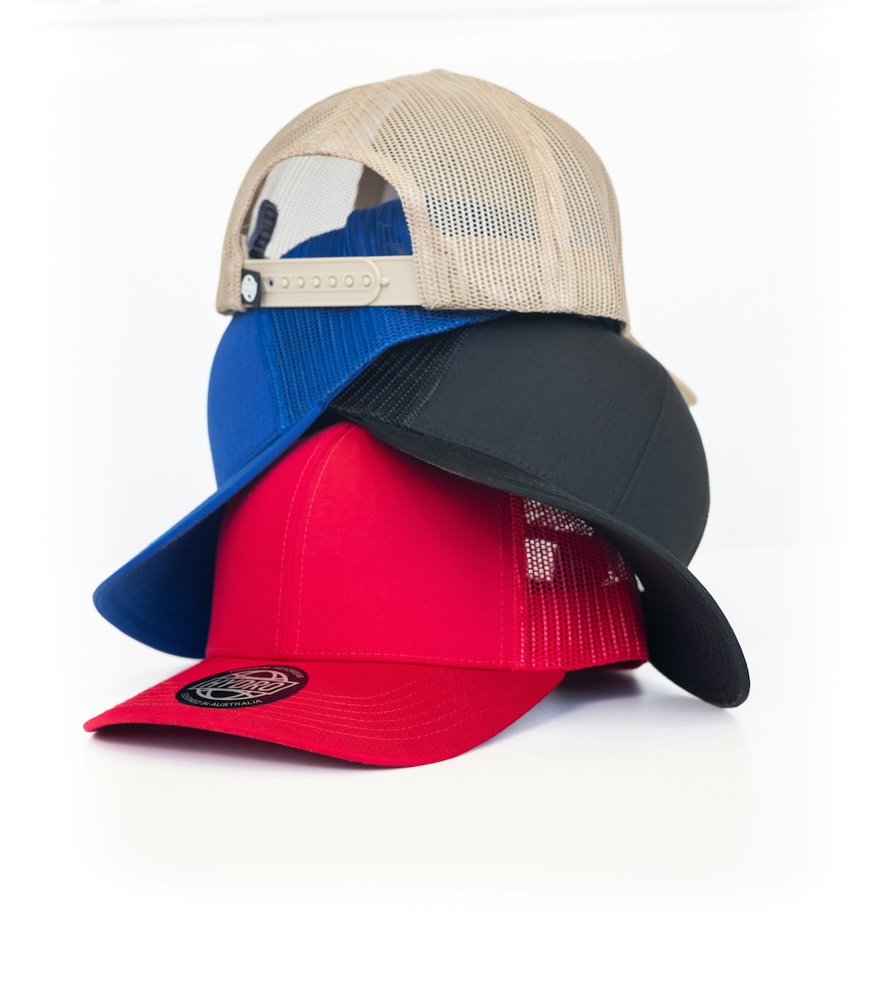

```{r setup, include=FALSE}
usethis::use_git_ignore(c("*.csv", "*.rds"))
options(htmltools.dir.version = FALSE)

library(knitr)
library(tidyverse)
library(xaringan)
library(fontawesome)
```


class: inverse, center, middle

# `r fa("fas fa-images", fill = "#fff")`

**View the slides:** 

[bretsw.com/ade5083-fs26-module6](https://bretsw.com/ade5083-fs26-module6)


---

class: inverse, center, middle

# `r fa("fas fa-cubes-stacked", fill = "#fff")` <br><br> Welcome to Module 6:<br>Career Development


---

class: inverse, center, middle

# `r fa("fas fa-cubes-stacked", fill = "#fff")` <br><br>Ch. 12 (Werner, 2022)<br>Career Management and Development

---

# `r fa("fas fa-cubes-stacked", fill = "#fff")` Ch. 12: Emplymnt Relationship

### Change in how employees view jobs

```{r, out.width = "50%", echo = FALSE, fig.align = "center"}

```

.pull-left[

**Traditional view:**

- Stable foundation
- Org as "family"
- Career development is org's concern

]


.pull-right[

**Contemporary view:**

- "Permanent white water"
- Org as mutual benefit
- Career development is employee's concern

]


---

# `r fa("fas fa-cubes-stacked", fill = "#fff")` Ch. 12: Career Stages

.pull-left-30[

```{r, out.width = "100%", echo = FALSE, fig.align = "center"}

```

(Werner, 2022, Table 12.2, p. 411)

]

.pull-right-70[

### Four-Stage Model

1. **Occupational and Organizational Choice:** Develop identity and assess options  (18-30)

2. **Early Career:** Learn job and norms, increase competence (25-45)

3. **Mid Career:** Reaffirm or modify the plan (40-60)

4. **Late Career:** Remain productive and prepare for retirement  (55-retirement)

]


---

# `r fa("fas fa-cubes-stacked", fill = "#fff")` Ch. 12: Career Ecosystem

.pull-left-30[

```{r, out.width = "100%", echo = FALSE, fig.align = "center"}

```

(Werner, 2022, Table 12.3, pp. 415)

]

.pull-right-70[

### Career Development vs. Management

Systems view:

- People

- Job market

- Information systems

- Activities: 
  - exploration
  - goal setting
  - strategy development and implementation
  - 360-degree feedback
  - progress evaluation

]


---

class: inverse, center, middle
# `r fa("fas fa-clipboard-list", fill = "#fff")` <br><br>Ch. 13 (Werner, 2022)<br>Management Development

---

# `r fa("fas fa-clipboard-list", fill = "#fff")` Ch. 13: Managerial Roles

.pull-left-30[

```{r, out.width = "100%", echo = FALSE, fig.align = "center"}

```

]

.pull-right-70[

### Managers wear many hats

(content from Ch. 12, but fits better here)

1. Coach

2. Appraiser

3. Adviser

4. Referral agent

]


---

# `r fa("fas fa-clipboard-list", fill = "#fff")` Ch. 13: Job/Task Analysis

.pull-left-30[

```{r, out.width = "100%", echo = FALSE, fig.align = "center"}

```
]

.pull-right-70[

### For management development:

- Take a holistic view of the manager's job

- Identify roles and competencies of managers

- Conduct a needs assessment

- Reflect on the competencies of future managers

]


---

class: inverse, center, middle

# `r fa("fas fa-binoculars", fill = "#fff")` <br><br> Looking Ahead

---

# `r fa("fas fa-calendar-day", fill = "#fff")` Semester Schedule

```{r, out.width = "360px", echo = FALSE, fig.align = "center"}
include_graphics("img/across-time.jpg")
```

- **Module 1:** Foundations of HRD

- **Module 2:** Assessing Learning Needs & Designing HRD Programs

- **Module 3:** Implementing and Evaluating HRD Programs

- **Module 4:** Onboarding & Training

- **Module 5:** Performance Management

- **Module 6: Career Development**

- **Module 7:** Organizational Development


---

# `r fa("fas fa-calendar-day", fill = "#fff")` Assignments

```{r, out.width = "300px", echo = FALSE, fig.align = "center"}

```

###`r fa("fas fa-keyboard", fill = "#782F40")` Final Project (25%)

- Project Proposal (0 points) - Module 2

- Annotated Bibliography 1 (50 points) - Module 3

- **Annotated Bibliography 2 (50 points) - Module 6**

- HRD Project Report (150 points) - Module 7


---

# `r fa("fas fa-screwdriver-wrench", fill = "#fff")` Module 6 Assignment

.pull-left[

```{r, out.width = "90%", echo = FALSE, fig.align = "center"}
include_graphics("img/6-6-books.jpg")
```

]

.pull-right[

### Annotated Bibliography 2

(50 points)

- Find 5 more quality articles related to you project topic
- Read the articles
- Use GenAI to summarize each one
- Write your own reflection (no GenAI) on why these articles are interesting and useful for your project

]
  
  
  
  
  
---

class: inverse, center, middle

# `r fa("fas fa-question", fill = "#fff")` <br><br> Questions

<hr>

**What questions can I answer for you now?**

**How can I support you this week?**

<hr>

`r fa("envelope", fill = "#fff")` [bret.staudtwillet@fsu.edu](mailto:bret.staudtwillet@fsu.edu) | `r fa("globe", fill = "#fff")` [bretsw.com](https://bretsw.com) | `r fa("fab fa-github", fill = "#fff")` [GitHub](https://github.com/bretsw/)